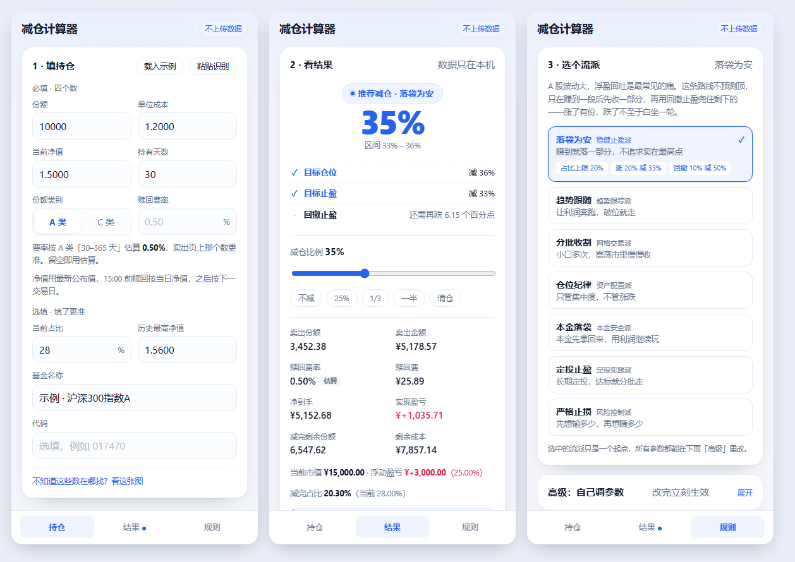

# 减仓计算器

> 抄四个数，算清楚：该减多少、要付多少赎回费、现在减还是等几天。



[](https://github.com/fanpaisk/jiancang/actions/workflows/ci.yml)
[](https://jiancang-b3b.pages.dev/)
[](LICENSE)

**30 秒了解**：填四个数（份额 / 单位成本 / 当前净值 / 持有天数）→ 选一个流派或自己调规则 → 看该减多少、付多少赎回费、现在减还是等几天。纯前端、零后端，数据只存浏览器；只做场外开放式基金，不做投资建议。

**状态**：v1.2.0 · 171 个测试 · CI 通过 · [在线体验](https://jiancang-b3b.pages.dev/) · [更新日志](CHANGELOG.md)

纯前端 · 不上传数据 · 免费开源 · 在线地址：<https://jiancang-b3b.pages.dev/>

演示：`?demo=1`（亏损场景） / `?demo=2`（盈利场景），均为**合成数据**，不是真实持仓。

---

## 它解决的问题

大多数基民只会加仓。跌了补，涨了也补，但很少有人事先想清楚「什么时候减、减多少」。

真正的问题不是「不知道该减多少」，而是两件事：

1. **没有规则。** 涨了想再涨一点，跌了舍不得，每次都在情绪里临场决策。
2. **有规则也执行不了。** 知道该减，但下不去手；卖飞了后悔，下次更不敢卖。

所以这个工具不做「我告诉你该卖」——那既没有标准答案，也不合规。它做的是：**你冷静时定规则，它负责盯、算、提醒，并在触发时告诉你精确到份额的执行方案。**

---

## 三个设计判断

### 1. 不做建议者，做执行器

所有输出都可追溯到用户自己设的参数。文案永远是「按你设定的规则，触发减仓 1,234 份」，而不是「建议减仓」。

这一条同时解决三件事：合规（不构成投顾）、信任（错了是规则的事）、责任归属（决定权在人手里）。

### 2. 不做账本，抄平台算好的费率

中国公募基金赎回默认**先进先出、按笔计费**，费率取决于每一笔份额的持有天数。要精确算，就得还原完整交易流水——对用户是天大的录入负担，对开发者是个无底洞。

但**平台本来就算好了**。每个 App 的卖出页都会显示「预计赎回费 / 赎回费率」。

> 你不需要重算一个平台已经算好的数，你只需要让用户抄一个数。

所以输入只有：份额、成本、净值、持有天数（用来自动推费率档），加上一个可选的「平台真实费率」。

### 3. 不套费率模板

费率因基金而异，尤其 C 类：有的 7 天后归零，有的 30 天后归零。

举个例子：`017470`（嘉实上证科创板芯片 ETF 联接 C）持有 107 天，赎回费**已经是 0**。如果套一张通用 A 类表，会算出 0.5%——**用户会为了一个不存在的费用而等待**。

所以内置表只是**默认估算值**，永远允许覆盖，永远标注「估算，以平台为准」，并且默认值刻意偏保守（宁可高估费用）。

---

## 先选流派，再谈参数

小白打开规则面板会一脸懵：目标占比、回撤阈值、达标减仓比例——**这些名字意味着他得先知道自己想干什么，而这恰恰是他不知道的**。

所以默认界面不暴露参数，而是给七个流派：选一个跟着走就行。

| 流派 | 一句话 | 核心规则 |
|---|---|---|
| 落袋为安 · 稳健止盈派 | 赚到就落一部分，不追求卖在最高点 | 占比上限 20% · 涨 20% 减 1/3 · 回撤 10% 减 1/2 |
| 趋势跟随 · 趋势跟踪派 | 让利润奔跑，破位就走 | 回撤 8% 减 1/2 · 跌 15% 减 1/2 |
| 分批收割 · 网格交易派 | 小口多次，震荡市里慢慢收 | 涨 12% 减 1/4 · 回撤 6% 减 1/4 |
| 仓位纪律 · 资产配置派 | 只管集中度，不管涨跌 | 占比上限 15% |
| 本金落袋 · 本金安全派 | 本金先拿回来，用利润继续玩 | 卖出本金 · 回撤 15% 减 1/2 |
| 定投止盈 · 定投实践派 | 长期定投，达标就分批走 | 涨 30% 减 1/2 · 回撤 15% 减 1/3 |
| 严格止损 · 风险控制派 | 先想输多少，再想赚多少 | 涨 15% 减 1/3 · 回撤 8% 减 1/2 · 跌 10% 减 1/2 |

流派只是起点：选中后参数会填进「高级」，随时可以逐条改；改过之后界面会显示「自定义中」。

### 为什么不用真人姓名命名

「巴菲特流派」「索罗斯流派」听起来更有跟随感，但没这么做，原因有三：

1. **事实不符。** 绝大多数投资大师没有机械化的减仓规则。把「长期持有、几乎不卖」压缩成「回撤 10% 减一半」，懂行的人一眼看穿，小白被误导。
2. **法律风险。** 用真人姓名做产品功能命名，容易被理解为本人背书。
3. **反噬最狠。** 一旦参数被当成「某人的策略」，用户亏钱时会同时归因到那个人和我们身上。

所以采用「流派名 + 思想来源」：风格名给方向感，`idea` 里写清它借的是哪套公开交易思想（海龟法则、网格交易、资产配置再平衡），既站得住脚，也不冒充。

---

## 五条规则（高级）

五条规则，每条都有明确算式，用户自己开关和调参：

| 规则 | 触发条件 | 减仓比例 | 算式 |
|---|---|---|---|
| 目标仓位 | 占比 > 目标 | 减到目标 | `(1 − 目标/当前) / (1 − 目标)` |
| 目标止盈 | 收益率 ≥ 目标 | 用户设定 | 固定比例（默认 1/3） |
| 回撤止盈 | 从峰值回撤 ≥ 阈值 | 用户设定 | 固定比例（默认 1/2） |
| 收回本金 | 收益率 > 0 | 卖出成本额 | `持仓成本 / 当前市值` |
| 止损线 | 亏损 ≥ 阈值 | 用户设定 | 默认关闭 |

**推荐值 = 所有已触发规则的中位数**，同时给出区间（最小 ~ 最大）。

> 目标仓位那条的公式值得单独说：卖出后组合总市值会同步减少（现金离开基金资产），所以解是 `(1 − t/w) / (1 − t)`，不是 `1 − t/w`。用后者会**少减**——30% 想降到 20%，算出来减 33.3%，实际只降到 22.2%，根本没到目标。这个错误一开始就在代码里，是靠「卖出后占比必须精确回到目标」这条测试抓出来的。

为什么是中位数而不是加权平均？因为每条规则都是用户自己设的、有明确算式的解，没有谁更权威。中位数对极端值不敏感，而区间天然揭示了规则之间的分歧——如果一条说减 10%、一条说减 90%，你该看到的是「分歧很大」，而不是一个被平均掉的假精确。

**没有任何规则触发时，推荐值就是 0%。** 这不是空状态，这就是答案：工具不会为了给建议而给建议。

---

## 费率边界（这个项目真正容易写错的地方）

| 持有天数 | A 类 | C 类 |
|---|---|---|
| < 7 天 | 1.5% | 1.5% |
| 7–30 天 | 0.75% | 0.5% |
| 30–365 天 | 0.5% | 0 |
| 365–730 天 | 0.25% | 0 |
| ≥ 730 天 | 0 | 0 |

两个坑：

1. **边界必须含端点。** 第 7 天要算进 7–30 天档，第 30 天要算进 30–365 天档。差一天就是 1 个百分点的费用。
2. **浮点数会骗你。** `(1.5 − 1.35) / 1.5` 在 IEEE 754 下等于 `0.09999999999999998`，比阈值 0.1 小。用户明明踩在「回撤正好 10%」上，却触发不了。所有阈值比较都走 `gte / lte / gt` 的容差函数——这个 bug 是被测试抓出来的。

---

## 适用范围：只做场外开放式基金

明确支持：**场外开放式公募基金**——普通开放式、ETF 联接、LOF 的场外份额、A/C 类、QDII（费率必须抄平台）。

不做的，以及为什么：

| 品种 | 为什么不做 |
|---|---|
| 场内 ETF / LOF | 有实时成交价、券商佣金，没有赎回费，完全是另一套模型 |
| 股票 | 印花税、佣金、过户费、T+1，还涉及除权除息 |
| 货币基金 | 通常无赎回费，这套费率逻辑不适用 |
| 银行理财 / 保险 | 没有份额概念，有封闭期和赎回限制 |
| 券商资管 / 私募 | 规则各异，且有合格投资者限制 |

**窄一点是刻意的。** 基金是唯一「净值单一、费率规则清晰、没有盘中价格」的品类，这三点恰好是这个工具成立的前提。硬扩到股票，就要重做一套费用与时点模型，风险和成本都远大于收益。

---

## 算得准吗

分两类看，别混在一起。

**纯算术，没有假设（这些是准的）**

- 市值、成本、浮动盈亏、收益率
- 卖出份额、卖出金额（以你填的净值为准）
- 赎回费 = 卖出金额 × 费率
- 减完剩余份额、剩余成本、实现盈亏
- 目标仓位：减完占比精确回到目标（有测试守着）

**带假设，必须标注（这些是估的）**

| 项 | 误差来源 |
|---|---|
| 净值 | 用最新公布值，不是实际成交净值；15:00 截止，之后算下一交易日 |
| 费率 | 内置表是估算；跨档持仓的真实费率是分笔加权，不是一个数 |
| 成本 | 假设「单位成本」已含申购费；若只填了净值成本，会少算 |
| 分红 | 假设红利再投已由平台并入份额与成本 |

结论：**误差主要来自两个输入（净值、费率），不来自算术本身。** 所以界面上一直摆着口径说明和「以平台为准」——把不确定性说清楚，比假装精确更可信。

---

## 为什么是纯前端

- **免备案**：没有服务器，静态托管即可
- **零成本、永久在线**：作品集最怕链接失效
- **隐私是卖点**：持仓数据留在浏览器 `localStorage`，不上传任何服务器
- **合规最干净**：没有后端，就没有「你在收集用户持仓」的想象空间

代价是不能跨设备同步。所以提供**导出 / 导入 JSON**，换设备拖进去就恢复，不做账号系统。

提醒同理：没有后端就发不了推送，于是把「费率跳档日」导出成 **`.ics` 日历事件**，让手机日历到点提醒——零成本、跨平台、用户可控。

---

## 两个降低门槛的小设计

**引导图示。** 用户最容易卡在「这个数去哪抄」，所以输入区里放了一张示意图：持仓页抄哪五行、卖出页抄哪个费率、净值走势里怎么找最高点。刻意不用真实 App 截图——界面一改图就废，而且示意图能把「抄哪一行」标得更清楚。

**分享卡片。** canvas 手绘 1080×1080，零依赖。在中文内容生态里，**图片比链接好传播**：微信、小红书对外链的限制很多，但对图片几乎没有。卡片只画结论，不带持仓明细。

---

## 手机上：三页，一屏一件事

| 页 | 内容 |
|---|---|
| **持仓** | 四个必填 + 选填字段 + 引导图示 |
| **结果** | 推荐比例、规则状态、卖出明细、临界点、分享卡片 |
| **规则** | 七个流派 + 高级参数 + 备份与计算口径 |

底部固定标签栏，也可以左右滑动切页——横向位移必须明显大于纵向（60px 阈值 + 1.6 倍比例），否则会和页内正常滚动打架。

输入页在 390×844 上刚好一屏；更小的机型会滚动一点点。**十个字段装不进 667px 是物理限制，不是设计偷懒**——所以能省的是字段数量，不是让用户眯着眼看。

---

## 产品化外壳

界面之外，这一版把「像一个正式工具」的部分补齐了：

- **顶部栏**：品牌、数据不外传徽章、「更多」入口。
- **首次使用**：三步引导，可跳过；`localStorage` 记住，不打扰老用户。
- **三个标签**：持仓 / 规则 / 结果。规则在结果之前，因为结果由规则决定。
- **示例模式**：`?demo=1/2` 显示黄色横幅，分享卡片带「示例数据」水印，避免被当成真实持仓转发。
- **分享卡片**：canvas 手绘，右下角带预生成二维码与站点地址，图片传播能回站。
- **更多**：导出 / 导入 / 清空、计算口径、隐私说明、FAQ、版本、GitHub 与反馈。
- **PWA**：可添加到主屏幕，离线能打开外壳；OCR 引擎与中文模型首次使用时才下载。
- **出错兜底**：渲染出错不再白屏，给刷新和回首页两条出路。

---

## 目录结构

```
src/
  core/                纯函数，无 DOM 依赖，100% 可测
    types.ts           数据模型
    fee.ts             费率分档、下一档推算、估算
    position.ts        持仓汇总（市值/成本/盈亏/收益率）
    plan.ts            单笔卖出试算（份额/费用/净到手/剩余）
    rules.ts           五条规则求值
    presets.ts         七个流派预设 + 命中检测
    recommend.ts       推荐值（中位数 + 区间）
    parse.ts           粘贴文本解析（正则，不是 OCR）
    layout.ts          OCR 版面配对：坐标 → 字段（纯函数）
    ics.ts             费率跳档日 → .ics 日历文件
    storage.ts         本地持久化
    format.ts          展示格式化
    util.ts            容差比较、中位数、安全转数字
  app/useAppState.ts   状态、派生数据与动作（页面只消费它）
  pages/               持仓 / 规则 / 结果三页的组装层
  shell/               顶部栏、标签栏、更多弹层、首次引导、示例横幅
  ui/                  通用原语：Button / Sheet / Icon / ErrorBoundary
  components/          业务区块（输入、结果、流派、OCR、引导图示）
  lib/ocr.ts           tesseract 引擎装配 + 图片预处理
  lib/shareCard.ts     canvas 绘制分享卡片
  styles/
    tokens.css         颜色 / 圆角 / 间距 / 字号 / 阴影
    shell.css          外壳与通用 UI
  config.ts            品牌、版本、站点链接
  App.tsx              只做外壳与页面切换
```

**`core/` 不 import 任何 React 或 DOM。** 计算与展示彻底分离，是能写测试的前提。页面与业务区块之间只通过 `AppState` 传参，换页面布局或重写某一页时不用动 `core/`。

---

## 开发

```bash
pnpm install
pnpm dev        # 开发服务器（predev 会先拷 OCR 资源）
pnpm test       # 171 个用例
pnpm typecheck  # tsc --noEmit
pnpm build      # 产物在 dist/
pnpm audit      # 依赖安全扫描
pnpm verify     # typecheck + test + build，提交前跑这一条
```

测试覆盖的重点不是覆盖率数字，而是**错一次就是钱的地方**：

- 7 / 30 / 365 / 730 天四个费率边界，A、C 两类
- 浮点阈值（回撤正好 10% 必须触发）
- 粘贴解析（用真实持仓页的原始文本做用例）
- 推荐值的中位数与区间
- 流派预设：id/名称唯一、每个都能跑通规则引擎、默认参数必须命中默认流派
- `.ics` 生成：CRLF、按 UTF-8 字节折行、保留字符转义
- 导出/导入的字段完整性

---

## 截图识别：为什么最后还是做了

一开始我把它列进了「不做」——OCR 是脏活，准确率不稳。但真实用户会嫌手动填四个数麻烦，所以最后做了，只是换了个做法：**不追求"读出文字"，而是"用坐标还原表格"**。

### 关键难点不是识别，是版面

基金 App 的持仓页是三列网格：

```
持有金额   持有份额   持仓占比     ← 标签行
1,209.70   591.28     19.3%       ← 数值行
```

OCR 直接读出来是「持有金额 持有份额 持仓占比 / 1,209.70 591.28 19.3%」，**按文字顺序配对必然张冠李戴**。

所以 `core/layout.ts` 做的是：按 y 坐标把词聚成行 → 找到标签的 x 区间 → 在**下一行**找与之 x 轴重叠最多的数值。标签和数值同行（另一种 App 布局）也支持。

实测（真实截图，浏览器内完整流程）：

```
shares 591.28 · costPerShare 2.9833 · holdDays 107
weightPct 19.3 · marketValue 1209.7 · returnRatePct -31.42
六个字段全中，约 2 秒
```

还有一个真实的坑：`1,209.70` 的千分位逗号被识别成小数点，变成 `1.209.70`。`parseOcrNumber` 专门处理了这个模式（两个点且中间是三位数 → 第一个点是千分位）。

除了数字，核对列表还会列出**基金名称、代码、A/C 类别**：代码只从页面上部/名称附近找，类别从名称后缀推断，推断不出就提示手选，不会静默默认 A。**当日涨跌幅**也会识别，但目前只记录，不参与规则。

名称和代码只要有一次同时确认过，就会写入本机缓存（最多 500 条）；下次只读到其中一边时，用它补另一边和缺失的类别。只做精确匹配，不猜。

### 三个工程决策

1. **引擎全部自托管**。`jsdelivr` 在国内被墙，tesseract 默认的 CDN 路径直接失败。所以 worker、wasm、中文模型都放本站，由 `scripts/copy-ocr-assets.mjs` 在 dev/build 前从 `node_modules` 拷进 `public/`（不入库）。
2. **按需加载**。`tesseract.js` 是动态 `import()`，主包只多了 9KB；用户不点就不下载。
3. **绝不静默填入**。识别结果先列出来让用户核对，点「填入表单」才写进去。OCR 一定会有错，问题是要让人看见错在哪。

代价：首次约 5MB（3.7MB 引擎 + 1.6MB 中文模型），之后走缓存。

所以输入区仍然把**粘贴识别**放在前面——长按复制文字更快、更准、零下载；截图识别是它失效时的备选。

---

## 明确不做的

| 不做 | 为什么 |
|---|---|
| 交易流水 / 账本 | 录入负担远大于收益；费率抄平台更准 |
| 多基金组合 / 仓位再平衡 | v1 只做单只，先把「算得准」做扎实 |
| 云同步 / 账号 | 需要后端，破坏纯前端的所有优势 |
| 投资建议 / 估值分位 | 越界，且没有标准答案 |
| 小程序 | 个人主体做金融类目基本走不通 |

---

## 已知边界

- 内置费率表是**估算**，真实费率以平台为准（UI 上始终标注）
- 不支持分笔 FIFO 精确费用计算——这是刻意的取舍，不是遗漏
- 只支持单只基金

---

## 文档

- [决策记录](docs/DECISIONS.md)：每个决定的理由与被否方案
- [当前状态](docs/STATUS.md)：下一步、已知缺陷、验收结果
- [部署说明](docs/DEPLOY.md)：Cloudflare Pages、CSP、上线检查
- [更新日志](CHANGELOG.md)
- [安全策略](SECURITY.md) · [参与贡献](CONTRIBUTING.md) · [问题反馈](https://github.com/fanpaisk/jiancang/issues/new/choose)

---

## 免责声明

本工具只做算术，不构成投资建议。所有减仓比例均由用户自己设定的规则推导得出，请以你所在平台显示的费率与规则为准。投资有风险，决策请自负。

## License

MIT
